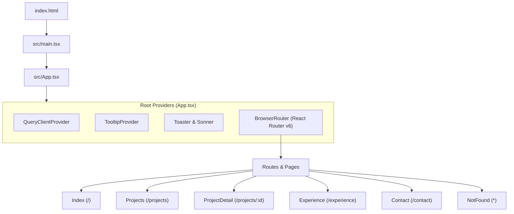

# Architecture & Setup Specification

## 1. High-Level Architecture

The repository is a client-side Single Page Application (SPA) built on top of **React 18**, **TypeScript**, and **Vite**. It contains no custom backend server; data is currently maintained in structured TypeScript structures inside pages and components, making the client lightweight, static-hostable, and fast.



---

## 2. Tooling & Configuration Details

### Vite Configuration ([vite.config.ts](file:///C:/Users/gandl/Documents/yaseeng-md/vite.config.ts))
* **Host & Port**: Configured to serve on `::` (all network interfaces) on port `8080`:
  ```ts
  server: {
    host: "::",
    port: 8080,
  }
  ```
* **Plugins**:
  - `@vitejs/plugin-react-swc`: Fast SWC-based JSX transformation.
  - `componentTagger()` from `lovable-tagger` (active in `development` mode only).
* **Path Alias**:
  - `@` is mapped to `./src` using `path.resolve(__dirname, "./src")`.
  - Always use `@/components/...`, `@/lib/...`, `@/pages/...` for imports.

### TypeScript Configuration ([tsconfig.json](file:///C:/Users/gandl/Documents/yaseeng-md/tsconfig.json))
* References `tsconfig.app.json` and `tsconfig.node.json`.
* Target: Modern ES module bundling.
* Strict null checks and JSX preservation via React JSX runtime.

### shadcn/ui Configuration ([components.json](file:///C:/Users/gandl/Documents/yaseeng-md/components.json))
* **Style**: `default`
* **Base Color**: `slate`
* **Tailwind Config**: `tailwind.config.ts`
* **Global CSS**: `src/index.css`
* **CSS Variables**: `true`

---

## 3. Application Lifecycle & Bootstrapping

1. **HTML Mounting**: [index.html](file:///C:/Users/gandl/Documents/yaseeng-md/index.html) loads `#root` container and imports `/src/main.tsx`.
2. **DOM Initialization**: [src/main.tsx](file:///C:/Users/gandl/Documents/yaseeng-md/src/main.tsx) creates the React 18 root via `createRoot(document.getElementById("root")!).render(<App />)`.
3. **Provider Wrapping**: [src/App.tsx](file:///C:/Users/gandl/Documents/yaseeng-md/src/App.tsx) wraps the route tree with:
   - `QueryClientProvider` (TanStack React Query)
   - `TooltipProvider` (Radix Tooltip root)
   - `<Toaster />` (Radix Toast viewport)
   - `<Sonner />` (Sonner toast viewport)
   - `<BrowserRouter>` for HTML5 client-side history routing.

---

## 4. Environment & Execution Requirements

To execute commands or run this repository:
1. **Node.js**: Requires Node.js v18+ or v20+ LTS (with npm).
2. **Commands**:
   * Install dependencies: `npm install` (or `bun install`)
   * Start local dev server: `npm run dev` (starts on `http://localhost:8080`)
   * Production build: `npm run build` (outputs to `dist/`)
   * Linting: `npm run lint`
