# Relationship & Dependency Graph

This document visualizes the dependencies and relationships across all modules, pages, components, and static assets in the repository.

---

## 1. Complete Visual Dependency Graph

```mermaid
graph TD
    %% Entry Point
    Main["src/main.tsx"] --> App["src/App.tsx"]
    App --> Route_Index["Route: / (src/pages/Index.tsx)"]
    App --> Route_Projects["Route: /projects (src/pages/Projects.tsx)"]
    App --> Route_Detail["Route: /projects/:id (src/pages/ProjectDetail.tsx)"]
    App --> Route_Experience["Route: /experience (src/pages/Experience.tsx)"]
    App --> Route_Blogs["Route: /blogs (src/pages/Blogs.tsx)"]
    App --> Route_Contact["Route: /contact (src/pages/Contact.tsx)"]
    App --> Route_404["Route: * (src/pages/NotFound.tsx)"]

    %% Shared Layout Components
    Header["src/components/Header.tsx"]
    Footer["src/components/Footer.tsx"]

    %% Pages to Layout & Feature Components
    Route_Index --> Header
    Route_Index --> Hero["src/components/Hero.tsx"]
    Route_Index --> SkillsSec["src/components/SkillsSection.tsx"]
    Route_Index --> ProjSec["src/components/ProjectsSection.tsx"]
    Route_Index --> ExpSec["src/components/ExperienceSection.tsx"]
    ExpSec --> PubSec["src/components/PublicationsSection.tsx"]
    Route_Index --> BlogsSec["src/components/BlogsSection.tsx"]
    Route_Index --> ContactF["src/components/ContactForm.tsx"]
    Route_Index --> Footer

    Route_Blogs --> Header
    Route_Blogs --> BlogsSec
    BlogsSec --> BlogCard["src/components/BlogCard.tsx"]
    Route_Blogs --> Footer

    Route_Projects --> Header
    Route_Projects --> ProjCard["src/components/ProjectCard.tsx"]
    Route_Projects --> Footer

    Route_Detail --> Header
    Route_Detail --> Route_404
    Route_Detail --> Footer

    Route_Experience --> Header
    Route_Experience --> AboutSec["src/components/AboutSection.tsx"]
    Route_Experience --> ExpSec
    Route_Experience --> Footer

    Route_Contact --> Header
    Route_Contact --> ContactF
    Route_Contact --> Footer

    %% Feature Components to Primitives
    ProjSec --> ProjCard

    %% UI Primitives
    Header --> UI_Button["components/ui/button.tsx"]
    Footer --> UI_Button
    Hero --> UI_Button
    SkillsSec --> UI_Card["components/ui/card.tsx"]
    ProjCard --> UI_Card
    ProjCard --> UI_Badge["components/ui/badge.tsx"]
    ProjCard --> UI_Button
    ExpSec --> UI_Card
    Route_Detail --> UI_Badge
    Route_Detail --> UI_Button

    %% Common Utils
    UI_Button --> Utils["src/lib/utils.ts (cn)"]
    UI_Card --> Utils
    UI_Badge --> Utils

    %% Static Assets
    Hero -.-> Nav_Projects["Navigates to /projects"]
    Hero -.-> Nav_Contact["Navigates to /contact"]
    Header -.-> ResumePDF["/resume.pdf"]
    ProjCard -.-> PublicImages["/sar.jpg, /audio.jpg, /explicit.jpg, /recc.jpg, /fight.jpg, /llama-summary.jpg"]
    Route_Detail -.-> PublicImages
```

---

## 2. Component Dependency Matrix

| Component | File Path | Imported By | Imports (Components / UI) | External Libraries |
| :--- | :--- | :--- | :--- | :--- |
| **`App`** | `src/App.tsx` | `src/main.tsx` | All 6 Pages, `Toaster`, `Sonner`, `TooltipProvider` | `react-router-dom`, `@tanstack/react-query` |
| **`Header`** | `src/components/Header.tsx` | `Index`, `Projects`, `ProjectDetail`, `Experience`, `Contact` | `ui/button` | `lucide-react` (`Menu`, `X`), `react-router-dom` (`Link`, `useLocation`) |
| **`Footer`** | `src/components/Footer.tsx` | `Index`, `Projects`, `ProjectDetail`, `Experience`, `Contact` | `ui/button` | `lucide-react` (`Github`, `Linkedin`, `Mail`) |
| **`Hero`** | `src/components/Hero.tsx` | `Index` | `ui/button` | `lucide-react` (`ArrowRight`), `react-router-dom` (`useNavigate`) |
| **`ProjectsSection`** | `src/components/ProjectsSection.tsx` | `Index` | `ProjectCard`, `ui/button` | `lucide-react` (`ArrowRight`), `react-router-dom` (`Link`) |
| **`ProjectCard`** | `src/components/ProjectCard.tsx` | `ProjectsSection`, `Projects` | `ui/card`, `ui/badge`, `ui/button` | `lucide-react` (`Github`), `react-router-dom` (`Link`) |
| **`SkillsSection`** | `src/components/SkillsSection.tsx` | `Index` | `ui/card` | `lucide-react` (`Code`, `Database`, `CodeSquare`, `DatabaseIcon`, `ServerIcon`, `Speech`) |
| **`AboutSection`** | `src/components/AboutSection.tsx` | `Experience` | `ui/card`, `ui/badge` | `lucide-react` (`Sparkles`, `Brain`, `Cpu`) |
| **`ExperienceSection`** | `src/components/ExperienceSection.tsx` | `Index`, `Experience` | `ui/card` | None |
| **`ContactForm`** | `src/components/ContactForm.tsx` | `Index`, `Contact` | None | `lucide-react` (`Github`, `Linkedin`, `Mail`, `Phone`) |
| **`Index`** | `src/pages/Index.tsx` | `App.tsx` | `Header`, `Hero`, `SkillsSection`, `ProjectsSection`, `ExperienceSection`, `ContactForm`, `Footer` | None |
| **`Projects`** | `src/pages/Projects.tsx` | `App.tsx` | `Header`, `Footer`, `ProjectCard` | None |
| **`ProjectDetail`** | `src/pages/ProjectDetail.tsx` | `App.tsx` | `Header`, `Footer`, `NotFound`, `ui/badge`, `ui/button` | `lucide-react` (`Github`, `ArrowLeft`), `react-router-dom` (`useParams`, `Link`) |
| **`Experience`** | `src/pages/Experience.tsx` | `App.tsx` | `Header`, `Footer`, `AboutSection`, `ExperienceSection`, `ui/card` | None |
| **`Contact`** | `src/pages/Contact.tsx` | `App.tsx` | `Header`, `Footer`, `ContactForm` | None |
| **`NotFound`** | `src/pages/NotFound.tsx` | `App.tsx`, `ProjectDetail` | None | `react-router-dom` (`useLocation`) |

---

## 3. Static Asset Mapping ([public/](file:///C:/Users/gandl/Documents/yaseeng-md/public))

| Public Asset | Type | Referenced By | Target / Context |
| :--- | :--- | :--- | :--- |
| `/images/profile.webp` | Image (WebP) | `Hero.tsx`, `AboutSection.tsx` via `PROFILE.image.src` | Optimized production portrait (800x800) |
| `/ProfilePic.jpg` | Image (JPEG) | Preserved original asset | Authentic high-res source photograph (1599x1599) |
| `/resume.pdf` | Document | `Header.tsx`, `Hero.tsx` | Navigation & Hero "Download Resume" buttons |
| `/sar.jpg` | Image | `ProjectsSection.tsx`, `Projects.tsx`, `ProjectDetail.tsx` | SAR Image Colorization project card & details |
| `/audio.jpg` | Image | `ProjectsSection.tsx`, `Projects.tsx`, `ProjectDetail.tsx` | Audio Deepfake Detection project card & details |
| `/explicit.jpg` | Image | `ProjectsSection.tsx`, `Projects.tsx`, `ProjectDetail.tsx` | Explicit Content Detection project card & details |
| `/recc.jpg` | Image | `Projects.tsx`, `ProjectDetail.tsx` | Movie Recommendation System project card & details |
| `/fight.jpg` | Image | `Projects.tsx`, `ProjectDetail.tsx` | Real-Time Fight Detection project card & details |
| `/llama-summary.jpg` | Image | `Projects.tsx`, `ProjectDetail.tsx` | Website Article Summarization with LLaMA 2 |
| `/favicon.ico` | Icon | `index.html` | Browser tab icon |
